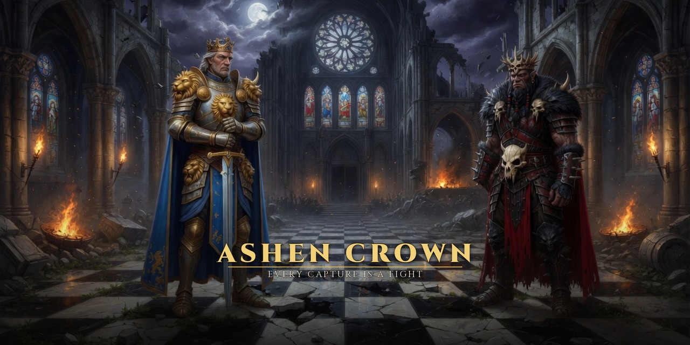

# Ashen Crown



A Battle Chess-style game in Qt and QML. Alliance (white, moves first) faces the Horde. The field is black and grey marble. Every capture is a fight, and the fight follows the two pieces on the board. Play a warlord, share one table, or march across the network. Buy me a coffee opens the PayPal page inside the window.

The pictures, music, and sound are original. This is fan-inspired and does not use Blizzard art, names of heroes, or logos.

## Build

Qt 6.12 is expected at `/home/andreas/Qt/6.12.0/gcc_64`.

```bash
cmake -S . -B build -DCMAKE_PREFIX_PATH=/home/andreas/Qt/6.12.0/gcc_64 -DCMAKE_BUILD_TYPE=Release
cmake --build build -j
./run.sh
./run.sh --selftest
```

`run.sh` points the loader at that Qt and opens the window on `DISPLAY` (default `:1`).

## Release

`scripts/release.sh` reads `VERSION` and packs Linux x86_64, Windows x86_64, and macOS arm64. The macOS app is self-signed as TheWhiteWitchTM. It is not notarized. Those packages open Buy me a coffee in the browser. A local Linux build that finds Qt WebEngine still opens it in the window.

## How a match is played

- **Battle the Horde / Alliance** — you take the side you picked. Novice sometimes plays a random legal move. Veteran, Warlord, and Legend search deeper.
- **Two at one table** — the board turns so the side to move sits at the bottom.
- **Across the warfront** — one player waits and shares the warcode. The other pastes it and marches.
- **Over Bluesky** — both sign in, type each other's handle, and sit. Moves travel as public posts on that account's firehose, then the post is deleted.

Click a piece, then a marked square. A quiet move slides. A capture opens the arena; the pawn still fights, then promotes if it reached the last rank. Esc skips a clash.

## Over the network

The host listens on TCP 41777 and UDP 41779 (or the next free port). A LAN beacon on UDP 41778 lists commanders on the same network.

A Bluesky table is the other road. Both commanders sign in with Bluesky. Each types the other's handle and sits. Ashen Crown watches that account on the public firehose. A move is a public post. When the other side has taken it, the post is deleted.

A march tries three paths:

1. The LAN address inside the warcode (about two seconds).
2. The public TCP port, if the router opened it with UPnP or NAT-PMP (about six seconds).
3. A UDP hole punch to the public port learned from the router or from STUN (about ten seconds).

Pasting `host:port` skips the warcode and dials TCP directly. That is the right move on a VPN.

One side waits. The other marches. If both march at once, the lower war token takes the host chair.

A symmetric NAT can still drop the punch. Forward the TCP port, or put both PCs on a VPN such as Tailscale and march to that address. The title screen plays a reel of clashes: a sword fight, a lance charge, a cannon shot.

## Pieces

| | Alliance | Horde |
| --- | --- | --- |
| Pawn | Footman | Grunt |
| Knight | Paladin | Wolf Rider |
| Bishop | Priest | Witch Doctor |
| Rook | Cannon Keep | Demolisher |
| Queen | Archmage | Far Seer |
| King | Storm King | Warchief |

Notation in the chronicle is ordinary chess notation.
